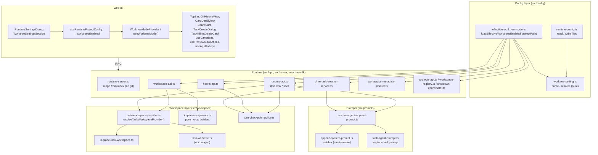
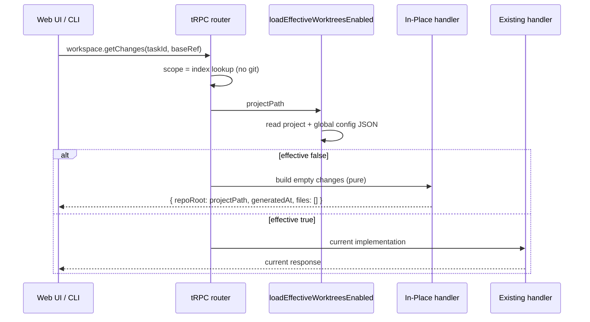

# Design Document: In-Place Workspace Mode

## Overview

This feature adds a boolean `worktreesEnabled` setting (global plus optional per-project override, default `false`). When the effective value for a project is `false` (In-Place Mode), every task agent and task shell runs with the project folder as its cwd, and Kanban stops creating worktrees, branches, turn checkpoints, ignored-path symlinks, task patches, commits, and PRs. When the value is `true` (Worktree Mode), today's code paths run unchanged.

The design is built around one idea: the mode is resolved per project, at call time, by a small pure resolver, and every git-touching runtime entry point asks that resolver before it does anything. The existing worktree implementation (`src/workspace/task-worktree.ts`, `turn-checkpoints.ts`, `git-sync.ts`, `git-history.ts`, `get-workspace-changes.ts`) is not modified. In-Place behavior is added next to it as separate, small modules, so Worktree Mode stays byte-for-byte the same code path.

Key findings from the codebase that shape the design:

- Config lives in `src/config/runtime-config.ts`. `writeRuntimeProjectConfigFile` currently deletes `<project>/.cline/kanban/config.json` whenever `shortcuts` is empty, so the project override needs that writer to change.
- Every tRPC request resolves its scope through `loadWorkspaceContextById` (`src/server/runtime-server.ts` → `src/state/workspace-state.ts`), which runs `git rev-parse` and `git for-each-ref` and throws for non-git folders. Scope resolution has to stop running git and stop rejecting non-git folders, or no In-Place endpoint can be a true no-op.
- Turn checkpoints are captured in three places: `startTaskSession` in `src/trpc/runtime-api.ts`, the `to_review` hook in `src/trpc/hooks-api.ts`, and `captureReviewCheckpoint` in `src/cline-sdk/cline-task-session-service.ts`.
- Task agents get no appended system prompt today. Only the home/sidebar agent does, via `resolveHomeAgentAppendSystemPrompt` (used by the Claude, Codex, Droid, and Kiro adapters in `src/terminal/agent-session-adapters.ts` and by the Cline SDK service). Commit/PR templates reach agents only when the web UI sends them through `web-ui/src/git-actions/build-task-git-action-prompt.ts`.
- The server-side `workspace-metadata-monitor.ts` polls git every second for the home repo and every active task worktree. That data feeds the top bar, card change counts, and auto-review in the web UI.
- `baseRef` must be non-empty in several places: `parseWorktreeEnsureRequest`, `parseTaskSessionStartRequest`, `parseShellSessionStartRequest` (`src/core/api-validation.ts`), `createTask` / `updateTask` (`src/core/task-board-mutations.ts`), the web UI card normalizer (`web-ui/src/state/board-state.ts`), and the CLI `resolveTaskBaseRef` (`src/commands/task.ts`). Non-git projects need empty `baseRef` to work.
- The web UI calls the Git endpoints from `use-git-actions.ts` and `components/git-history/use-git-history-data.ts`, and the Diff endpoints from `runtime/use-runtime-workspace-changes.ts` and `use-git-history-data.ts`.
- fast-check is not installed in the root or `web-ui` packages yet.

### Resolved: nullable baseCommit

Requirement 5.2 has `ensureWorktree` return `ok: true` with `baseCommit: null`, but the existing `runtimeWorktreeEnsureResponseSchema` `ok: true` branch declared `baseCommit: z.string()`.

Decision (confirmed): the `ok: true` branch becomes `baseCommit: z.string().nullable()`, and Requirement 5.1 now lists this widening next to the config fields. The change is additive for consumers. The only web UI consumer (`use-board-interactions.ts`) already copies the value into the nullable `headCommit`, and Worktree Mode keeps returning a string.

## Architecture



### Mode resolution flow



### Design decisions

1. **Resolve at call time, never cache across calls.** `loadEffectiveWorktreesEnabled(projectPath)` reads two small JSON files and does no agent detection (unlike `loadRuntimeConfig`, which can call `detectInstalledCommands`). This covers Req 5.9, 1.13, and 11.8 with no invalidation logic.
2. **Separate In-Place modules, unchanged Worktree modules.** In-Place behavior lives in new files and is chosen by a dispatch at each entry point. Worktree Mode (Req 13) runs the same functions as before.
3. **Running sessions keep their cwd.** Mode is applied when a session starts (Req 12.2, 12.8, 11.9). `TerminalSessionManager` restart requests already store `cwd`, so nothing extra is needed for running sessions.
4. **Checkpoint policy follows the effective setting at turn time.** Req 6.1 and 14.3 forbid writing refs under `.git` while the setting is `false`, even for a session that started in Worktree Mode. Each capture site asks `shouldCaptureTurnCheckpoint(projectPath)` right before capturing.
5. **Empty `baseRef` is valid data.** Board mutations and the web UI card normalizer accept `""`. The non-empty check moves to the Worktree path, where `resolveTaskCwd` and `ensureTaskWorktreeIfDoesntExist` already reject an empty `baseRef` with a descriptive error (Req 13.7). API parsers get an `allowEmptyBaseRef` option, which only In-Place handlers set.
6. **Web UI tri-state mode.** The web UI treats `worktreesEnabled` as `boolean | null`, where `null` means the config hasn't loaded yet. All git, diff, and auto-review behavior is gated on `=== true`, so In-Place never issues Git or Diff calls, even during loading (Req 8.4, 9.3). The auto-review suppression in Req 7.8 runs only on a real loaded `false → true` transition, so page loads in Worktree Mode behave as they do today (Req 13.5).

## Components and Interfaces

### Backend: config

#### `src/config/worktree-setting.ts` (new, pure, shared with web-ui via alias `@runtime-worktree-setting`)

```ts
/** Raw value -> valid setting or null (unset). Only JSON booleans are valid (Req 1.1, 1.7). */
export function parseWorktreeSettingValue(raw: unknown): boolean | null;

export interface WorktreeSettingSources {
	globalWorktreesEnabled: boolean | null;
	projectWorktreesEnabled: boolean | null;
}

/** Project override -> global -> default false (Req 1.4–1.6). */
export function resolveEffectiveWorktreesEnabled(sources: WorktreeSettingSources): boolean;

/** In-Place default baseRef: current branch or "" (Req 10.3). */
export function resolveInPlaceDefaultBaseRef(git: { currentBranch: string | null } | null): string;

export const DEFAULT_WORKTREES_ENABLED = false;
export const INVALID_WORKTREES_ENABLED_MESSAGE = "Invalid worktreesEnabled value: expected true or false.";
export const WORKTREES_REQUIRE_GIT_MESSAGE = "Git worktrees require a git repository.";
```

#### `src/config/effective-worktree-mode.ts` (new)

```ts
/** Reads both config files with no locks and no agent detection. Missing or unparsable files count as unset. */
export async function loadWorktreeSettingSources(projectPath: string | null): Promise<WorktreeSettingSources>;
export async function loadEffectiveWorktreesEnabled(projectPath: string): Promise<boolean>;
export async function loadGlobalWorktreesEnabled(): Promise<boolean>; // for Req 10.4–10.7
```

These reuse `getRuntimeGlobalConfigPath` / `getRuntimeProjectConfigPath` and the home-dir equality rule in `resolveRuntimeConfigPaths` (a project at `~` has no project config).

#### `src/config/runtime-config.ts` (modified)

- `RuntimeGlobalConfigFileShape` and `RuntimeProjectConfigFileShape` gain `worktreesEnabled?: unknown` (`unknown` because files may contain invalid values).
- `RuntimeConfigState` gains `globalWorktreesEnabled: boolean | null`, `projectWorktreesEnabled: boolean | null`, and `worktreesEnabled: boolean` (effective). `toRuntimeConfigState`, `createRuntimeConfigStateFromValues`, and `toGlobalRuntimeConfigState` populate them through `worktree-setting.ts`. The global state's effective value ignores any project override.
- `RuntimeConfigUpdateInput` gains `worktreesEnabled?: boolean` (global) and `projectWorktreesEnabled?: boolean | null` (`null` clears the override).
- `writeRuntimeGlobalConfigFile` handles the `worktreesEnabled` key:
  - Update provided: write it, except omit the key when the value is `false` and the key was absent before (Req 1.9).
  - No update provided: copy the existing raw value unchanged if the key exists, valid or not (Req 1.7 "leave contents unchanged").
- `writeRuntimeProjectConfigFile(configPath, { shortcuts, worktreesEnabled, existing })` writes a payload with `shortcuts` when non-empty and `worktreesEnabled` when it's a boolean, or when an untouched raw value is preserved. It deletes the file only when both are absent, which keeps today's cleanup behavior for shortcut-only projects (Req 1.12, 14.4).
- `updateRuntimeConfig(cwd, updates)` gains two guards, both checked before any write:
  - A project override with no project config path throws.
  - If the next effective value is `true` and `cwd` is not a git repository, it throws `WORKTREES_REQUIRE_GIT_MESSAGE` (Req 2.7). Writes stay inside the existing `lockedFileSystem.withLocks` block, and `hasChanges` includes the new fields.
- `updateGlobalRuntimeConfig` accepts `worktreesEnabled` only, never a project override.
- Write failures propagate. `lockedFileSystem.writeJsonFileAtomic` replaces the file atomically, so a failed write leaves the previous file content in place (Req 14.5).

#### `src/core/api-contract.ts` (modified)

```ts
// runtimeConfigResponseSchema additions (Req 1.8)
globalWorktreesEnabled: z.boolean().nullable(),
projectWorktreesEnabled: z.boolean().nullable(),
worktreesEnabled: z.boolean(),

// runtimeConfigSaveRequestSchema additions (Req 1.11, 2.4)
worktreesEnabled: z.boolean({ error: INVALID_WORKTREES_ENABLED_MESSAGE }).optional(),
projectWorktreesEnabled: z.boolean({ error: INVALID_WORKTREES_ENABLED_MESSAGE }).nullable().optional(),

// runtimeWorktreeEnsureResponseSchema ok:true branch (see "Resolved: nullable baseCommit")
baseCommit: z.string().nullable(),
```

`buildRuntimeConfigResponse` in `src/terminal/agent-registry.ts` copies the three new state fields.

### Backend: workspace identity without git

#### `src/state/workspace-state.ts` (modified)

- `resolveWorkspacePath(cwd)`: if `detectGitRoot` returns null, return the canonical `realpath(cwd)` instead of throwing. Git repos still resolve to their top level.
- `detectGitRepositoryInfo(repoPath)`: return `{ currentBranch: null, defaultBranch: null, branches: [] }` for non-git folders instead of throwing. Git info stays read-only (`rev-parse`, `symbolic-ref`, `for-each-ref`) and is still needed in In-Place Mode for Req 10.3.
- New `loadWorkspaceScopeById(workspaceId): Promise<{ workspaceId; repoPath } | null>` reads only the workspace index. It runs no git and does not stat the repo.

#### `src/server/runtime-server.ts` (modified)

`resolveWorkspaceScopeFromRequest` uses `loadWorkspaceScopeById` instead of `loadWorkspaceContextById`, so resolving a scope never spawns git (Req 5.7). The board snapshot (`buildWorkspaceStateSnapshot`) still uses `loadWorkspaceState`, which includes git info.

#### `src/server/workspace-registry.ts` (modified)

- `createWorkspaceRegistry`: when `cwd` is not a git repo and `loadGlobalWorktreesEnabled()` is `false`, it registers `cwd` through `loadWorkspaceContext(cwd)` (Req 10.6). Otherwise it keeps today's launch flow (Req 10.7).
- `resolveWorkspaceForStream`: the "not a git repository" removal applies only when that project's effective setting is `true`. Removal for missing folders is unchanged (Req 10.9, 10.10).

#### `src/cli.ts` (modified)

`tryOpenExistingServer` resolves a workspace id for non-git `cwd` the same way when the global setting is `false`.

### Backend: task workspace provider

#### `src/workspace/task-workspace-provider.ts` (new)

```ts
export type WorkspaceMode = "in_place" | "worktree";

export interface TaskWorkspaceProvider {
	readonly mode: WorkspaceMode;
	/** Start, resume, and shell cwd. Worktree: existing-or-ensure. In-place: projectPath after directory check (Req 3.1–3.9, 12.3). */
	resolveTaskCwd(input: { taskId: string; baseRef: string; ensure: boolean }): Promise<string>;
	ensureTaskWorkspace(input: { taskId: string; baseRef: string }): Promise<RuntimeWorktreeEnsureResponse>;
	deleteTaskWorkspace(input: { taskId: string }): Promise<RuntimeWorktreeDeleteResponse>;
	getTaskWorkspaceInfo(input: { taskId: string; baseRef: string }): Promise<RuntimeTaskWorkspaceInfoResponse>;
}

export function createTaskWorkspaceProvider(projectPath: string, worktreesEnabled: boolean): TaskWorkspaceProvider;
export async function resolveTaskWorkspaceProvider(projectPath: string): Promise<TaskWorkspaceProvider>;
```

The Worktree implementation forwards to the existing `resolveTaskCwd`, `ensureTaskWorktreeIfDoesntExist`, `deleteTaskWorktree`, and `getTaskWorkspaceInfo`. `deleteTaskWorktree` already returns `ok: true, removed: false` when no worktree exists (Req 12.6). The `resolveExistingTaskCwdOrEnsure` helper moves from `runtime-api.ts` into this implementation.

#### `src/workspace/in-place-task-workspace.ts` (new)

The In-Place implementation runs no git, creates no files, and never reads `~/.cline/worktrees`.

- `resolveTaskCwd` stats `projectPath`. If the path is missing or not a directory, it throws `ProjectFolderUnavailableError` with the message "Project folder is unavailable: <path>" (Req 3.9). Otherwise it returns `projectPath`.
- `ensureTaskWorkspace` returns `{ ok: true, path: projectPath, baseRef: input.baseRef, baseCommit: null }` (Req 5.2).
- `deleteTaskWorkspace` returns `{ ok: true, removed: false }` (Req 5.3).
- `getTaskWorkspaceInfo` returns `{ taskId, path: projectPath, exists: true, baseRef: input.baseRef, branch: null, isDetached: false, headCommit: null }` (Req 5.4).

#### `src/workspace/in-place-responses.ts` (new, pure)

```ts
export function createInPlaceGitSyncSummary(): RuntimeGitSyncSummary; // nulls and zeros
export function createInPlaceGitSummaryResponse(): RuntimeGitSummaryResponse;
export function createInPlaceGitSyncResponse(action: RuntimeGitSyncAction): RuntimeGitSyncResponse;
export function createInPlaceGitCheckoutResponse(branch: string): RuntimeGitCheckoutResponse;
export function createInPlaceGitDiscardResponse(): RuntimeGitDiscardResponse;
export function createInPlaceGitLogResponse(): RuntimeGitLogResponse; // commits [], totalCount 0
export function createInPlaceGitRefsResponse(): RuntimeGitRefsResponse; // refs []
export function createInPlaceCommitDiffResponse(commitHash: string): RuntimeGitCommitDiffResponse;
export function createInPlaceWorkspaceChangesResponse(projectPath: string, now: () => number): RuntimeWorkspaceChangesResponse;
```

All responses have `ok: true`, no `error`, and `output: ""` where the schema requires it (Req 5.5, 5.6). The existing `createEmptyWorkspaceChangesResponse` isn't reused because it runs `git rev-parse`.

#### `src/workspace/turn-checkpoint-policy.ts` (new)

```ts
export interface TurnCheckpointPolicy {
	shouldCaptureTurnCheckpoint(projectPath: string): Promise<boolean>;
}
export function createTurnCheckpointPolicy(deps?: { loadEffectiveWorktreesEnabled?: (p: string) => Promise<boolean> }): TurnCheckpointPolicy;
/** Copy of summary with latest/previousTurnCheckpoint = null (Req 6.3). */
export function clearTurnCheckpoints(summary: RuntimeTaskSessionSummary): RuntimeTaskSessionSummary;
```

### Backend: tRPC handlers

#### `src/trpc/workspace-api.ts` (modified)

`CreateWorkspaceApiDependencies` gains `loadEffectiveWorktreesEnabled: (workspacePath: string) => Promise<boolean>`. Each Worktree, Diff, and Git handler first resolves the mode:

| Procedure | In-Place response |
|---|---|
| `ensureWorktree` | provider `ensureTaskWorkspace` |
| `deleteWorktree` | provider `deleteTaskWorkspace` |
| `loadTaskContext` | provider `getTaskWorkspaceInfo` |
| `loadChanges`, `loadWorkspaceChanges` | `createInPlaceWorkspaceChangesResponse(workspacePath)` |
| `loadGitSummary` | `createInPlaceGitSummaryResponse()` |
| `runGitSyncAction` | `createInPlaceGitSyncResponse(input.action)` |
| `checkoutGitBranch` | `createInPlaceGitCheckoutResponse(body.branch)` |
| `discardGitChanges` | `createInPlaceGitDiscardResponse()` |
| `loadGitLog` | `createInPlaceGitLogResponse()` |
| `loadGitRefs` | `createInPlaceGitRefsResponse()` |
| `loadCommitDiff` | `createInPlaceCommitDiffResponse(input.commitHash)` |

In-Place handlers make no broadcasts, since nothing changed. Router-level zod `.input(...)` validation runs before any handler, so schema rejections are the same in both modes (Req 5.10). The In-Place path calls `parseWorktreeEnsureRequest(input, { allowEmptyBaseRef: true })` and skips the `normalizeRequiredTaskWorkspaceScopeInput` empty-`baseRef` check, but still requires a non-empty `taskId`. When the setting is `true`, the existing function bodies run as they do today (Req 5.11).

The dispatch is a small local helper so each handler stays readable:

```ts
const byMode = async <T>(scope: RuntimeTrpcWorkspaceScope, inPlace: () => T | Promise<T>, worktree: () => Promise<T>) =>
	(await deps.loadEffectiveWorktreesEnabled(scope.workspacePath)) ? await worktree() : await inPlace();
```

#### `src/core/api-validation.ts` (modified)

`parseWorktreeEnsureRequest`, `parseTaskSessionStartRequest`, and `parseShellSessionStartRequest` gain an optional `{ allowEmptyBaseRef?: boolean }`. The default `false` keeps current errors.

#### `src/trpc/runtime-api.ts` (modified)

- `startTaskSession`:
  - Resolve `worktreesEnabled` for the scope, then parse with `allowEmptyBaseRef: !worktreesEnabled`.
  - Get `taskCwd` from `provider.resolveTaskCwd({ ensure: true })`. Home-agent sessions keep using `workspacePath`.
  - `shouldCaptureTurnCheckpoint` additionally requires `worktreesEnabled`.
  - In In-Place Mode, clear the summary's checkpoints after start with `terminalManager.clearTurnCheckpoints(taskId)` / `clineTaskSessionService.clearTurnCheckpoints(taskId)` (Req 6.3).
  - Compute `appendSystemPrompt` with `resolveAgentAppendSystemPrompt` and pass it to `terminalManager.startTaskSession` (new optional `appendSystemPrompt` on `StartTaskSessionRequest`) or to `clineTaskSessionService.startTaskSession` (new optional `appendSystemPrompt` on `StartClineTaskSessionRequest`).
- `startShellSession`: the task-scoped cwd comes from the provider (Req 3.3).
- `saveConfig`: passes the new fields through `parseRuntimeConfigSaveRequest`. Errors from the git-repo guard surface as `TRPCError` `BAD_REQUEST` with the guard message (Req 2.7). Persistence errors surface as `INTERNAL_SERVER_ERROR` (Req 14.5).

Nothing in these paths imposes a per-project session limit. A repo search for concurrency caps (`maxConcurrent`, `MAX_PARALLEL`, and similar) found none, and In-Place adds none (Req 3.6).

#### `src/trpc/hooks-api.ts` and `src/cline-sdk/cline-task-session-service.ts` (modified)

- `CreateHooksApiDependencies` gains an optional `turnCheckpointPolicy`. The `to_review` branch captures and deletes stale refs only when `shouldCaptureTurnCheckpoint(workspacePath)` is true. The state transition and broadcasts stay unconditional (Req 6.1, 6.2).
- `ClineTaskSessionService` gets the policy and the project path through its scoped constructor. `captureReviewCheckpoint` checks the policy first. The service stops calling `resolveHomeAgentAppendSystemPrompt` itself and instead uses `request.appendSystemPrompt`. The runtime resolves that value through the shared resolver, so home sessions get the same text as before.
- Both `TerminalSessionManager` and `ClineTaskSessionService` gain `clearTurnCheckpoints(taskId)`, which emits a summary with both checkpoint fields `null`.

#### `src/trpc/projects-api.ts`, `src/server/shutdown-coordinator.ts` (modified)

- `addProject`: when `loadGlobalWorktreesEnabled()` is `false`, the project is registered with no `requiresGitInitialization` prompt, no `initializeGitRepository`, and no `ensureInitialCommit` (Req 10.4, 14.3). When it's `true`, today's flow runs (Req 10.5). `assertPathIsDirectory` still runs first (Req 10.10).
- `removeProject` and shutdown trash cleanup call `deleteTaskWorktree` only for projects whose effective setting is `true` (Req 12.4, 14.3).

#### `src/server/workspace-metadata-monitor.ts` (modified)

`CreateWorkspaceMetadataMonitorDependencies` gains `loadEffectiveWorktreesEnabled`. When it returns `false`, `refreshWorkspace` skips `loadHomeGitMetadata` and `loadTaskWorkspaceMetadata` and publishes `createEmptyWorkspaceMetadata()`. That means no git polling and no change counts reach the UI. The mode is re-read on every poll tick, so a settings change takes effect within one interval (1 s).

### Backend: prompts

#### `src/prompts/task-agent-prompt.ts` (new)

`renderInPlaceTaskAgentPrompt(projectPath: string): string` produces a short block that:

- states the agent works directly in the shared project folder and gives `projectPath` (Req 11.1)
- tells the agent not to run `git commit`, `git push`, `git branch`, `git checkout`, `git stash`, `git reset`, or `git worktree` (Req 11.2)
- warns that other agents and the user may edit the same files concurrently (Req 11.3)

It contains no other mention of worktrees, detached HEAD, commits, or PRs (Req 11.4).

#### `src/prompts/append-system-prompt.ts` (modified)

`RenderAppendSystemPromptOptions` gains `worktreesEnabled?: boolean` (default `true`, so all existing callers and tests get identical output, Req 11.6). With `false`, the sidebar prompt swaps the worktree intro and the "inside `.cline/worktrees/`" bullet for shared-folder wording. It also drops the auto-review paragraph and the `--base-ref` / `--auto-review-*` flags from the `task create` / `task update` references, and rewords `task done` / `task delete` / `task start` so they don't mention worktree cleanup (Req 11.5). The in-place sections live in `src/prompts/sidebar-prompt-in-place-sections.ts` so `append-system-prompt.ts` stays readable.

#### `src/prompts/resolve-agent-append-prompt.ts` (new)

```ts
export function resolveAgentAppendSystemPrompt(input: {
	taskId: string;
	projectPath: string;
	worktreesEnabled: boolean;
	commandPrefixOptions?: ResolveAppendSystemPromptCommandPrefixOptions;
}): string | null;
// home session  -> sidebar prompt with { worktreesEnabled }
// task, false   -> renderInPlaceTaskAgentPrompt(projectPath)
// task, true    -> null (identical to today)
```

#### `src/terminal/agent-session-adapters.ts` (modified)

`AgentAdapterLaunchInput` gains `appendSystemPrompt?: string | null`. The Claude, Codex, Droid, Kiro, and Cline adapters replace `resolveHomeAgentAppendSystemPrompt(input.taskId)` with `input.appendSystemPrompt ?? null`, through the same flags they already use (`--append-system-prompt`, `developer_instructions`, Kiro agent config). The Gemini and OpenCode adapters have no system-prompt channel today. For task sessions only, they prepend the in-place task prompt to the initial prompt text. Sidebar behavior for these two agents doesn't change.

The mode is resolved once, when the session starts. Restarts reuse the stored request, so a running session keeps its prompt (Req 11.9).

### Backend: CLI (`src/commands/task.ts`)

- New helper `loadWorkspaceWorktreesEnabled(runtimeClient)` reads `runtime.getConfig` (the existing procedure) and returns `worktreesEnabled`.
- `task create`: In-Place resolves the default with `resolveInPlaceDefaultBaseRef(state.git)` and skips the "Could not determine task base branch" error (Req 10.3, 10.8). Worktree Mode keeps `resolveTaskBaseRef` and its error.
- `task start`, `task trash` / `task done`, and `task delete` keep calling `ensureWorktree` / `deleteWorktree`. Those are no-ops in In-Place Mode, so no CLI branching is needed.
- `--auto-review-*` flags are stored unchanged (Req 7.5).

### Backend: board mutations (`src/core/task-board-mutations.ts`, shared as `@runtime-task-state`)

`createTask` and `updateTask` accept an empty trimmed `baseRef` and store it as `""` (Req 10.2, 10.3). Supplied values are stored trimmed, without branch validation. Trash, restore, delete, and linked-task auto-start logic is mode-independent and reused as-is (Req 4.2, 4.4, 4.5).

### Web UI

#### `web-ui/src/runtime/worktree-mode.tsx` (new)

```tsx
export interface WorktreeModeValue {
	/** null while the config is loading. */
	worktreesEnabled: boolean | null;
	/** Strict gate for git, diff, and auto-review behavior. */
	isWorktreeMode: boolean; // worktreesEnabled === true
}
export function WorktreeModeProvider(props: { value: boolean | null; children: React.ReactNode }): React.ReactElement;
export function useWorktreeMode(): WorktreeModeValue;
```

`App.tsx` derives the value from `runtimeProjectConfig?.worktreesEnabled ?? null` and wraps the board and detail tree in the provider. This is domain state consumed by many components, not a pass-through wrapper.

#### Gated components and hooks

| File | Change (In-Place) | Req |
|---|---|---|
| `components/top-bar.tsx` | Don't render the git history toggle, branch label/selector, or working-copy counts | 8.1, 8.2 |
| `App.tsx` | `handleToggleGitHistory` is a no-op. An effect closes git history when `isWorktreeMode` becomes false. Don't render `GitHistoryView`. | 8.3, 8.6 |
| `hooks/use-app-hotkeys.ts` | Accept `isGitHistoryEnabled` and skip the git-history hotkey binding when it's false | 8.3 |
| `hooks/use-git-actions.ts` | Accept `enabled`. Sync, checkout, discard, and commit/PR actions are no-ops, and history refresh is skipped. | 7.1, 8.4 |
| `components/git-history/use-git-history-data.ts` | Queries are `enabled` only when the view is mounted, and the view is never mounted in In-Place Mode | 8.4, 9.3 |
| `runtime/use-runtime-workspace-changes.ts` | New `enabled` arg folded into `hasWorkspaceScope` (covers polling and state-version refetch) | 9.3 |
| `components/card-detail-view.tsx` | Skip `DiffModeButton`s, `DiffViewerPanel`, `FileTreePanel`, the resize handle, the git history panel, and the commit/PR buttons. The agent terminal or Cline chat fills the content area at 100% width. | 7.1, 9.1, 9.4 |
| `components/board-card.tsx` | Skip `reviewChangeSummary`, the Commit/Open PR buttons, and the cancel-automatic-action control | 7.1, 9.2 |
| `components/task-create-dialog.tsx`, `task-inline-create-card.tsx` | Skip the "Worktree base ref" `BranchSelectDropdown` and the auto-review checkbox/select. Submit with `resolveInPlaceDefaultBaseRef(workspaceGit)`. Edit keeps the stored `baseRef` and auto-review values. | 7.2, 7.4, 10.1 |
| `hooks/use-review-auto-actions.ts` | New `enabled: boolean` and `worktreesEnabled: boolean \| null`. When disabled, clear all timers and skip evaluation. On a loaded `false → true` transition, snapshot the current review task ids into a suppressed set, and drop each id once its task leaves review. | 7.3, 7.6, 7.8 |
| `state/board-state.ts` | The card normalizer accepts an empty `baseRef`. The draft-update check allows `""`. | 10.2 |
| `components/runtime-settings-dialog.tsx` | New worktree section (below). Hide the commit/PR prompt template editor when the current effective setting is false, while still sending the loaded template values unchanged on save. | 2.x, 7.7 |
| `components/add-project-dialog.tsx`, `hooks/use-project-navigation.ts` | No change. The runtime simply no longer returns `requiresGitInitialization` when the global setting is false. | 10.4 |

The board-card and detail-view gates are plain conditional renders, never `hidden` or `display:none`, so nothing hidden stays in the DOM or receives focus (Req 8.1, 9.1).

#### `web-ui/src/components/settings/worktree-settings-section.tsx` (new)

- A Radix `Switch` labeled "Use git worktrees", styled like the existing notifications switch (`bg-surface-4`, `data-[state=checked]:bg-accent`) (Req 2.1).
- When a project is selected (`config.projectConfigPath !== null`), a Radix `RadioGroup` with three options: "Use global default", "Off (in-place)", and "On (worktrees)" (Req 2.2, 2.3). `@radix-ui/react-radio-group` isn't a dependency yet. If adding it is not acceptable, a `NativeSelect` with the same three options works too.
- `RuntimeSettingsDialog` owns the drafts (`draftGlobalWorktreesEnabled`, `draftProjectOverride: "global" | "off" | "on"`) and includes them in `hasUnsavedChanges`. Its `handleSave` adds `worktreesEnabled` and `projectWorktreesEnabled` only when they differ from the loaded values (Req 2.4). Closing without saving resets the drafts from `config` (Req 2.5). A save error keeps the dialog open with drafts intact and shows the runtime message, including `WORKTREES_REQUIRE_GIT_MESSAGE` (Req 2.7, 2.8).
- `useRuntimeConfig.save` currently swallows errors and returns `null`. It changes to return `{ ok: false, error }` so the dialog can show the message.
- After a successful save, the dialog's existing `onSaved` callback triggers `refreshRuntimeProjectConfig()` in `App.tsx`. The provider value updates in the same render pass, well inside the 2 s budget (Req 2.6, 7.8, 8.7, 9.5).

## Data Models

### Config files

```jsonc
// ~/.cline/kanban/config.json (Global_Config); key omitted when false and previously absent
{ "selectedAgentId": "claude", "worktreesEnabled": true }

// <project>/.cline/kanban/config.json (Project_Config); file removed when both keys are absent
{ "shortcuts": [ ... ], "worktreesEnabled": false }
```

Only the JSON booleans `true` and `false` are valid. Any other value (`"true"`, `0`, `null`, `{}`, `[]`) counts as unset when read and is preserved as-is when the key isn't being updated.

### Runtime state and API

```ts
interface RuntimeConfigState {
	// ...existing fields
	globalWorktreesEnabled: boolean | null;  // null = unset/invalid
	projectWorktreesEnabled: boolean | null; // null = unset/invalid or no project
	worktreesEnabled: boolean;               // effective
}

interface RuntimeConfigUpdateInput {
	// ...existing fields
	worktreesEnabled?: boolean;              // global
	projectWorktreesEnabled?: boolean | null; // null = clear override
}
```

`RuntimeConfigResponse` exposes the same three fields. `RuntimeConfigSaveRequest` exposes the two update fields.

### Effective resolution truth table

| Project override | Global | Effective |
|---|---|---|
| `true` | any | `true` |
| `false` | any | `false` |
| unset / invalid | `true` | `true` |
| unset / invalid | `false` | `false` |
| unset / invalid | unset / invalid | `false` |

### Unchanged models

- `RuntimeBoardCard.baseRef` stays `z.string()`. It's stored, but ignored in In-Place Mode, and may be `""`.
- `RuntimeBoardCard.autoReviewEnabled` and `autoReviewMode` are stored and returned unchanged in both modes (Req 7.4).
- `RuntimeTaskSessionSummary.latestTurnCheckpoint` and `previousTurnCheckpoint` are forced to `null` at session start and turn end in In-Place Mode.
- `RuntimeWorkspaceStateResponse.git` keeps the empty shape `{ currentBranch: null, defaultBranch: null, branches: [] }` for non-git projects.
- No new persisted state is introduced beyond the two config keys (Req 14.1).

## Correctness Properties

*A property is a characteristic or behavior that should hold true across all valid executions of a system-essentially, a formal statement about what the system should do. Properties serve as the bridge between human-readable specifications and machine-verifiable correctness guarantees.*

Overlaps from the prework were removed during reflection before these properties were written:

- Parse validity (1.1) folds into the resolution model (Property 1).
- Response-builder validity and the "no git, no writes" guarantee are checked together at the handler level (Property 9).
- Supplied and defaulted `baseRef` are one property (Property 15).
- Requirements 3.7, 4.3, 9.7, and 12.3 are covered by Properties 8 and 9.

### Property 1: Effective resolution matches the reference model

*For any* raw JSON values `g` and `p` stored under `worktreesEnabled` in Global_Config and Project_Config (including absent keys, missing files, booleans, strings `"true"`/`"false"`, numbers, `null`, objects, and arrays), the effective setting equals `typeof p === "boolean" ? p : typeof g === "boolean" ? g : false`, and the result is always a boolean.

**Validates: Requirements 1.1, 1.4, 1.5, 1.6, 1.7, 1.8**

### Property 2: Config save/load round trip

*For any* Global_Worktree_Setting and Project_Worktree_Override, each drawn from `{true, false, unset}`, and any valid values of the other config fields, saving the configuration and then loading it yields the same `globalWorktreesEnabled`, `projectWorktreesEnabled`, and `worktreesEnabled`. The loaded config response also validates against `runtimeConfigResponseSchema`.

**Validates: Requirements 1.2, 1.8, 1.10, 1.12, 1.13**

### Property 3: Project override isolation

*For any* two distinct project folders A and B and any sequence of override saves applied to A, Global_Config's `worktreesEnabled` key and B's Project_Config are byte-identical before and after the sequence.

**Validates: Requirements 1.3**

### Property 4: Invalid stored values are ignored and preserved

*For any* non-boolean JSON value stored under `worktreesEnabled` in either config file, loading the config leaves both files byte-identical and resolves as if the key were absent. Saving an unrelated field (for example `selectedAgentId` or `shortcuts`) leaves that raw value in place.

**Validates: Requirements 1.7**

### Property 5: Invalid saves are rejected without writes

*For any* save request whose `worktreesEnabled` or `projectWorktreesEnabled` is not a boolean (or, for the override, not `null`), `parseRuntimeConfigSaveRequest` throws an error mentioning `worktreesEnabled`, and both config files are byte-identical afterwards.

**Validates: Requirements 1.11**

### Property 6: Worktrees require git

*For any* combination of a stored state and a save request on a non-git project folder, the save is rejected with `WORKTREES_REQUIRE_GIT_MESSAGE` and both files are unchanged if and only if the resulting effective setting is `true`. Otherwise the save succeeds.

**Validates: Requirements 2.7**

### Property 7: Settings draft maps to the minimal save request

*For any* loaded `(globalWorktreesEnabled, projectWorktreesEnabled)` and any draft `(toggle, radio ∈ {global, off, on})`, the request built by the settings dialog contains `worktreesEnabled` exactly when the toggle differs from the loaded effective-global display value. It contains `projectWorktreesEnabled` exactly when the radio differs from the loaded override. The values map to `{global → null, off → false, on → true}`.

**Validates: Requirements 2.4**

### Property 8: In-Place task cwd is always the project folder

*For any* existing project directory, any task id, and any `baseRef` (including `""`, whitespace, and names of nonexistent branches), and whether or not a Task_Worktree exists for that task, the In-Place provider's `resolveTaskCwd` returns the project path and spawns no git process.

**Validates: Requirements 3.1, 3.7, 12.3**

### Property 9: In-Place endpoints are schema-valid, fully specified no-ops

*For any* Worktree, Diff, or Git endpoint and any input accepted by that endpoint's zod input schema, the In-Place handler returns a response that:

- parses with the endpoint's response schema
- has exactly the field values defined in Requirement 5 (`path`/`repoRoot` equal to the project path, echoed `baseRef`/`branch`/`action`/`commitHash`, empty lists, zero counts, null nullables, `ok: true`, no `error`)

It also spawns no git process and calls no filesystem write.

**Validates: Requirements 4.3, 5.1, 5.2, 5.3, 5.4, 5.5, 5.6, 5.7, 5.8, 9.7**

### Property 10: Mode is chosen per call

*For any* interleaved sequence of effective-setting changes and endpoint calls on one project, each response is the In-Place response when the setting at the time of that call is `false`, and the Worktree handler's response when it is `true`.

**Validates: Requirements 5.9, 5.11**

### Property 11: Turn completion never checkpoints in In-Place Mode

*For any* task session summary and hook event (`to_review`, `to_in_progress`, `activity`), ingesting the event in In-Place Mode produces the same summary state transition as in Worktree Mode and calls neither the checkpoint capture nor the checkpoint-ref deletion.

**Validates: Requirements 6.1, 6.2**

### Property 12: Checkpoint clearing is targeted

*For any* `RuntimeTaskSessionSummary`, `clearTurnCheckpoints` returns a summary whose `latestTurnCheckpoint` and `previousTurnCheckpoint` are `null` and whose other fields are deep-equal to the input.

**Validates: Requirements 6.3**

### Property 13: Auto-review fields survive board operations

*For any* board and any card with arbitrary `autoReviewEnabled`/`autoReviewMode`, moving the card through review, trash, and restore with the shared board mutations leaves both fields deep-equal to their original values.

**Validates: Requirements 7.4**

### Property 14: No auto-review while disabled or for pre-existing review tasks

*For any* board, `useReviewAutoActions` with fake timers schedules no git action while `enabled` is false. After a `false → true` transition, it schedules no action for any task that was already in review at the transition, until that task leaves review.

**Validates: Requirements 7.3, 7.6, 7.8**

### Property 15: In-Place `baseRef` storage

*For any* supplied `baseRef` string, `createTask` stores `baseRef.trim()` without validation. *For any* `RuntimeGitRepositoryInfo` (including `null` and `currentBranch: null`), a task created without a supplied `baseRef` in In-Place Mode stores `resolveInPlaceDefaultBaseRef(git)`, which is `git?.currentBranch ?? ""`.

**Validates: Requirements 10.2, 10.3**

### Property 16: In-Place task prompt content

*For any* absolute project path string, `renderInPlaceTaskAgentPrompt(path)`:

- contains the path
- states that work happens in the shared folder
- names each of `commit`, `push`, `branch`, `checkout`, `stash`, `reset`, and `worktree` in the prohibition list
- includes the concurrent-editing notice

Once the prohibition list is removed, the remaining text contains none of "worktree", "detached HEAD", "pull request", or "commit".

**Validates: Requirements 11.1, 11.2, 11.3, 11.4**

### Property 17: In-Place sidebar prompt has no worktree guidance

*For any* command prefix and agent id, `renderAppendSystemPrompt(prefix, { agentId, worktreesEnabled: false })` contains none of "worktree", "--base-ref", "auto-commit", "auto-open-pr", or "--auto-review", and it mentions the shared project folder.

**Validates: Requirements 11.5**

### Property 18: Worktree Mode prompts are unchanged

*For any* command prefix and agent id, `renderAppendSystemPrompt(prefix, { agentId, worktreesEnabled: true })` equals the pre-feature output (a golden snapshot of the current function, captured before the change). *For any* non-home task id, `resolveAgentAppendSystemPrompt({ worktreesEnabled: true })` returns `null`.

**Validates: Requirements 11.6**

## Error Handling

| Situation | Behavior | Req |
|---|---|---|
| Non-boolean `worktreesEnabled` in a config file | Treated as unset, file untouched, no error | 1.7 |
| Non-boolean value in a save request | zod rejects with `INVALID_WORKTREES_ENABLED_MESSAGE` and nothing is written. tRPC surfaces `BAD_REQUEST`. | 1.11 |
| Save would make the effective setting `true` on a non-git project | `updateRuntimeConfig` throws `WORKTREES_REQUIRE_GIT_MESSAGE` before writing. The UI shows it and keeps the dialog open with drafts intact. | 2.7, 2.8 |
| Config write fails (permissions, disk) | Atomic write leaves the old file. `saveConfig` returns `INTERNAL_SERVER_ERROR`, the previous effective value stays in place, and the UI keeps the previous mode. | 14.5, 2.8 |
| Project folder missing at In-Place task start | `ProjectFolderUnavailableError` → `startTaskSession` returns `{ ok: false, error: "Project folder is unavailable: …" }`. The existing start-failure handling in `use-task-start-actions.ts` and the CLI `task start` keeps the card in its column. Implementation must check that the web UI revert path covers this response. | 3.9 |
| Project folder missing or unreadable at add | `assertPathIsDirectory` rejects regardless of mode | 10.10 |
| Worktree Mode start with empty or unresolvable `baseRef` | Existing `ensureTaskWorktreeIfDoesntExist` errors ("Task base branch is required…" / `getWorktreeBaseRefResolutionErrorMessage`) are returned. No worktree is created and the card stays put. | 13.7 |
| Worktree Mode trash for a task with no worktree | `deleteTaskWorktree` already returns `{ ok: true, removed: false }` | 12.6 |
| Non-git project in In-Place Mode | `loadWorkspaceContext` returns empty git info. The metadata monitor publishes empty metadata. No git-error toast appears, because Git endpoints are never called. | 6.5, 10.9 |
| Git repo with no commits added while global is `false`, later switched to worktrees | No initial commit is created at add time (Req 14.3). Worktree creation then fails with the existing missing-initial-commit message (`isMissingInitialCommitError`). This is acceptable and documented. | 10.4, 14.3 |
| Mode resolver read error (corrupt JSON) | `readRuntimeConfigFile` already returns `null`, which resolves to the default `false` | 1.6 |

## Testing Strategy

### Libraries and setup

- **Vitest** (existing) for all unit, integration, and web UI tests.
- **fast-check** for property tests. It isn't installed yet. Add it as an exact-pinned devDependency in both the root and `web-ui/package.json` (`npm install --save-dev --save-exact fast-check` in each), at the current 4.x release resolved at install time. Don't write a home-grown generator framework.
- Every property test runs at least 100 iterations (`fc.assert(prop, { numRuns: 100 })`, or more for cheap pure properties).
- Each property test carries a tag comment in the form `// Feature: in-place-workspace-mode, Property {n}: {property title}`. Each property is implemented by a single property test.
- New tests use a temp directory for `HOME` (via `vi.spyOn(os, "homedir")`, or by setting `HOME`/`USERPROFILE` before importing modules that capture it) and a temp project folder. A shared helper `test/utilities/temp-kanban-home.ts` provides `withTempKanbanHome()` and `createTempProject({ git: boolean })` (Req 15.8).

### Property tests (files and mapping)

| File | Properties |
|---|---|
| `test/runtime/config/worktree-setting.property.test.ts` | 1 |
| `test/runtime/config/runtime-config-worktree.property.test.ts` | 2, 3, 4, 5, 6 |
| `test/runtime/workspace/in-place-task-workspace.property.test.ts` | 8, 12 |
| `test/runtime/trpc/workspace-api-in-place.property.test.ts` | 9, 10 (git spawn spied by mocking `runGit` / `node:child_process`) |
| `test/runtime/trpc/hooks-api-in-place.property.test.ts` | 11 |
| `test/runtime/prompts/in-place-prompts.property.test.ts` | 16, 17, 18 |
| `test/runtime/core/task-board-mutations-in-place.property.test.ts` | 13, 15 |
| `web-ui/src/components/settings/worktree-settings-section.property.test.tsx` | 7 (pure `buildWorktreeSaveRequest` helper) |
| `web-ui/src/hooks/use-review-auto-actions.property.test.tsx` | 14 (fake timers, generated boards) |

The test for Property 18 needs a golden snapshot. Before changing `append-system-prompt.ts`, check in `test/runtime/prompts/__snapshots__/` holding the current output for each agent id and a few command prefixes. The property then compares against it.

### Example and integration tests

- **Config examples:** key omitted when writing `false` with the key absent (1.9), clearing the override removes the key and deletes an otherwise empty file (1.12), a write failure injected via a failing `lockedFileSystem` mock (14.5), and `.cline/kanban` as the only folder created (14.4).
- **Runtime API examples** (mocked managers):
  - `startTaskSession` and `startShellSession` use the project path (3.2, 3.3).
  - Ten concurrent starts give ten sessions (3.6).
  - A missing project folder is rejected (3.9).
  - The In-Place prompt is passed to adapters, and the commit/PR templates aren't (11.7, 11.8).
  - A running session keeps its prompt and cwd after a mode flip (11.9, 12.8).
- **Filesystem snapshot integration** (`test/integration/in-place-mode.integration.test.ts`): a real temp git repo plus a temp HOME with the global setting `false`. Take a full recursive path+content snapshot of the project (including `.git/info/exclude`, refs, `git branch --list`, and `~/.cline/worktrees`), then run task start, a hook `to_review`, trash, restore, and permanent delete through the runtime. Assert snapshots are equal apart from `.cline/kanban` and that `refs/kanban/checkpoints/*` is unchanged (3.4, 3.5, 4.1–4.3, 6.4, 12.1, 12.4, 14.2, 14.3, 15.7). Run a second variant on a non-git folder (3.8, 5.8, 6.5, 10.9, 15.6).
- **CLI integration:** launching from a non-git cwd with global `false` registers it (10.6). `task create` with and without `--base-ref` in a non-git project exits 0 (10.8). `--auto-review-*` flags are stored (7.5).
- **Projects API examples:** with global `false`, a non-git add returns no `requiresGitInitialization` and creates no `.git` (10.4). With global `true`, today's prompt runs (10.5).
- **Web UI examples** (Testing Library, the provider set explicitly in each test):
  - Settings dialog toggle and radio rendering, save, cancel, and error states (2.1–2.3, 2.5, 2.6, 2.8).
  - The prompt-template editor is hidden in In-Place Mode (7.7).
  - Board card and detail view show no commit/PR, diff, change-count, or git-history elements (`queryBy…` returns `null`) (7.1, 9.1, 9.2, 9.4).
  - Create and edit dialogs show no base-ref or auto-review controls (7.2, 10.1).
  - The top bar has no git elements, and the hotkey is a no-op (8.1–8.3).
  - A mocked tRPC client records zero Git and Diff calls across board load, task selection, visibility change, and project switch (8.4, 9.3).
  - Switching the mode closes git history and toggles the UI without a reload (8.6, 8.7, 9.5).
  - Worktree Mode renders everything as today (8.5, 9.6, 13.4).

### Existing suites (Req 15.1–15.3)

Existing tests keep their assertions. Tests that exercise worktrees, checkpoints, patches, mirroring, commit/PR, Git UI, or Diff UI set the mode explicitly in their own setup:

- **Backend integration tests** (`test/integration/task-worktree.integration.test.ts`, `runtime-state-stream.integration.test.ts`, and similar) write `{"worktreesEnabled": true}` into the temp HOME's Global_Config through `enableWorktreesForTest(homeDir)` in `test/utilities/worktree-mode.ts` before starting the runtime.
- **Backend unit tests** that build `createWorkspaceApi`, `createHooksApi`, or the metadata monitor pass `loadEffectiveWorktreesEnabled: async () => true` (or `turnCheckpointPolicy` always `true`). These dependencies are required on purpose, so a missing setup fails at type-check rather than silently running In-Place Mode.
- **Web UI tests** for `board-card`, `card-detail-view`, `top-bar`, `git-history-view`, `use-git-actions`, `use-review-auto-actions`, `use-board-interactions`, and `runtime-settings-dialog` wrap renders in `<WorktreeModeProvider value={true}>` via a `renderWithWorktreeMode` helper in `web-ui/src/test-utils/`.
- **Prompt tests** in `test/runtime/` that assert the current sidebar text call `renderAppendSystemPrompt` without the new option, which defaults to `true`.

Run `npm run check` and `npm run web:test` as the completion gate (Req 15.1). No existing test is removed, skipped, or marked todo (Req 15.2).

### Why some criteria are not property tests

UI visibility (Req 2, 7–9), CLI launch, and the filesystem-snapshot guarantees are either rendering checks or expensive I/O with no meaningful input space. One or two well-chosen examples catch the same bugs as 100 runs, so they're covered by example and integration tests. Property tests cover the pure and mockable logic: resolution, config persistence, response builders, mode dispatch, checkpoint gating, board mutations, prompt rendering, and the auto-review state machine.
